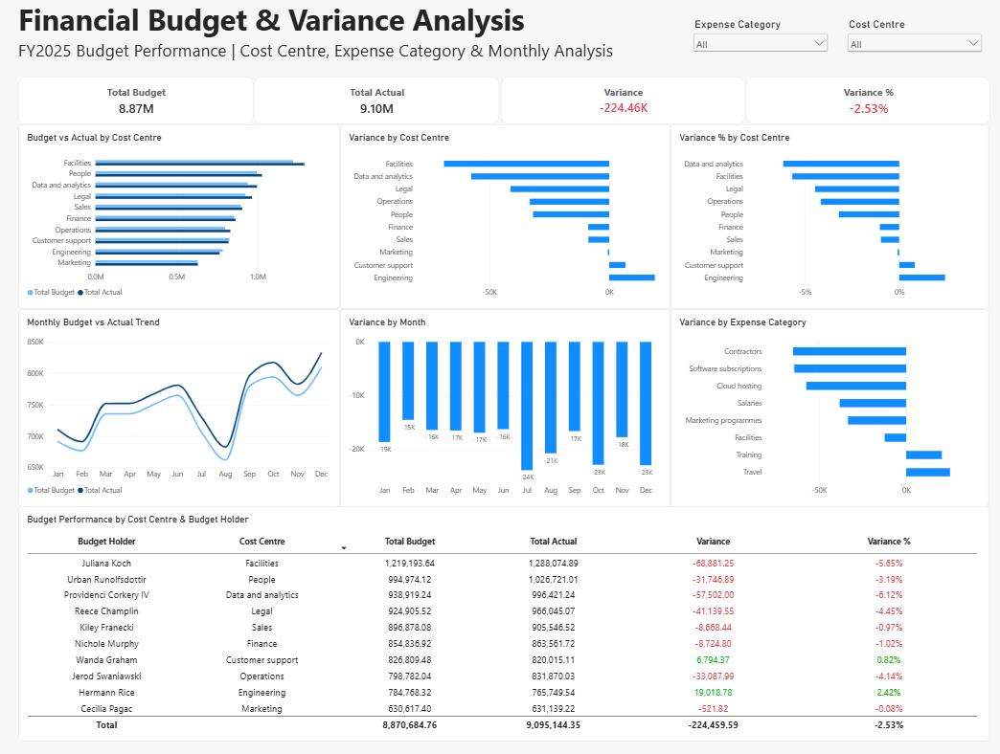

# Financial Budget & Variance Analysis

A financial data analysis project using Excel, Power Query, Power Pivot, DAX, and Power BI to compare budgeted and actual spending across cost centres, expense categories, and months.

The project focuses on identifying areas that went over or under budget and presenting the results through an interactive Power BI dashboard.

## Dashboard



## Project Objectives

The main objectives of this project were to:

- Compare budgeted and actual spending.
- Measure budget variance in both amount and percentage.
- Identify cost centres with the largest budget differences.
- Analyse which expense categories contributed to overspending.
- Review monthly budget performance.
- Build an interactive dashboard for financial performance monitoring.

## Tools Used

- Microsoft Excel
- Power Query
- Power Pivot
- DAX
- Power BI
- GitHub

## Dataset

The project uses a budget-versus-actual dataset containing four related tables:

- accounts — expense categories such as Salaries, Contractors, Cloud hosting, and Travel.
- cost_centres — business units and their budget holders.
- months — monthly records for January to December 2025.
- budget_lines — detailed budget, actual spending, and variance records.

The analysis covers 10 cost centres, 8 expense categories, and 12 months of 2025.

## Data Model

The four tables were loaded and prepared using Power Query before being added to the Excel Data Model.

The model follows a star-schema structure:

- Fact table: budget_lines
- Dimension table: accounts
- Dimension table: cost_centres
- Dimension table: months

Relationships were created between:

- budget_lines[account_id] → accounts[id]
- budget_lines[cost_centre_id] → cost_centres[id]
- budget_lines[month_id] → months[id]

## Analysis Process

### 1. Data Preparation

The four CSV files were imported into Excel using Power Query.

Data types were checked and corrected before the tables were loaded into the Data Model.

### 2. Data Modelling

Relationships were created between the main budget table and the three supporting tables.

This allowed budget performance to be analysed by cost centre, expense category, and month.

### 3. Excel Analysis

PivotTables were used to compare:

- Total Budget
- Total Actual Spending
- Variance
- Variance %

A DAX measure was created for Variance %:

```DAX
Variance % =
DIVIDE(
    SUM(budget_lines[variance_amount]),
    SUM(budget_lines[budget_amount])
)
```

### 4. Power BI Dashboard

An interactive Power BI dashboard was created with:

- Total Budget KPI
- Total Actual KPI
- Variance KPI
- Variance % KPI
- Budget vs Actual by Cost Centre
- Variance by Cost Centre
- Variance % by Cost Centre
- Variance by Expense Category
- Monthly Budget vs Actual Trend
- Variance by Month
- Budget performance by Cost Centre and Budget Holder
- Cost Centre and Expense Category filters

## Key Findings

- Total budget was $8.87M, while actual spending reached $9.10M.
- Overall spending was $224.46K above budget, equal to 2.53% over budget.
- Facilities had the largest overspending amount at $68.88K.
- Data and Analytics had the highest overspending percentage at 6.12%.
- Engineering and Customer Support were the only cost centres that stayed below budget.
- Salaries had the largest overspending amount within both Facilities and Data and Analytics.
- Software subscriptions had a high overspending percentage in both Facilities and Data and Analytics.
- Actual spending was higher than budget in every month of 2025.

## Recommendations

Based on the analysis:

- Review Facilities and Data and Analytics first because they showed the largest budget differences.
- Review spending in Salaries, Contractors, Cloud hosting, and Software subscriptions.
- Monitor budget versus actual spending every month to identify overspending earlier.
- Consider setting alerts when spending goes above an agreed budget limit.
- Review recurring areas of overspending when preparing future budgets.

## Project Structure

```text
Financial_Budget_Analysis/
├── 01_Raw_Data/
│   ├── accounts.csv
│   ├── budget_lines.csv
│   ├── cost_centres.csv
│   └── months.csv
├── 02_Excel/
│   └── Financial_Budget_Analysis.xlsx
├── 03_PowerBI/
│   └── Financial_Budget_Variance_Dashboard.pbix
├── 04_Analysis/
│   └── business_insights.md
├── 05_Images/
│   └── financial_budget_dashboard.png
└── README.md
```

## Skills Demonstrated

- Financial data analysis
- Budget vs actual analysis
- Variance analysis
- Data cleaning and preparation
- Data modelling
- Power Query
- Power Pivot
- DAX
- Excel PivotTables
- Power BI dashboard development
- Data visualisation
- Business insight generation